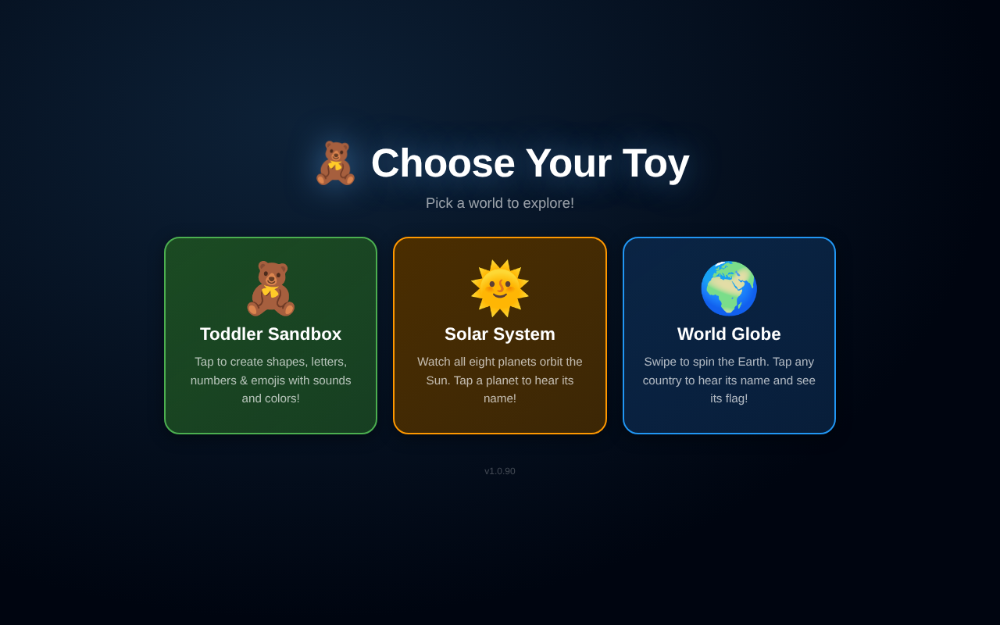
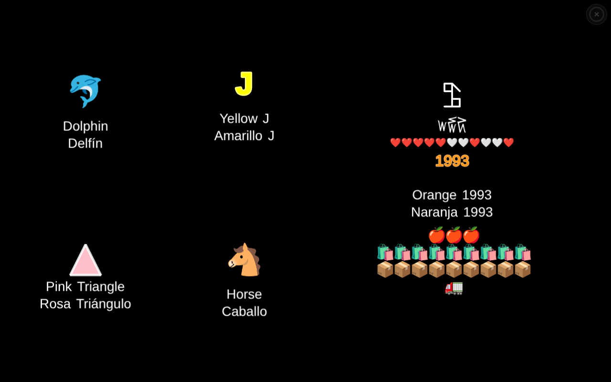
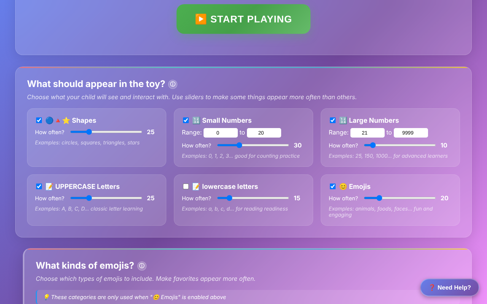
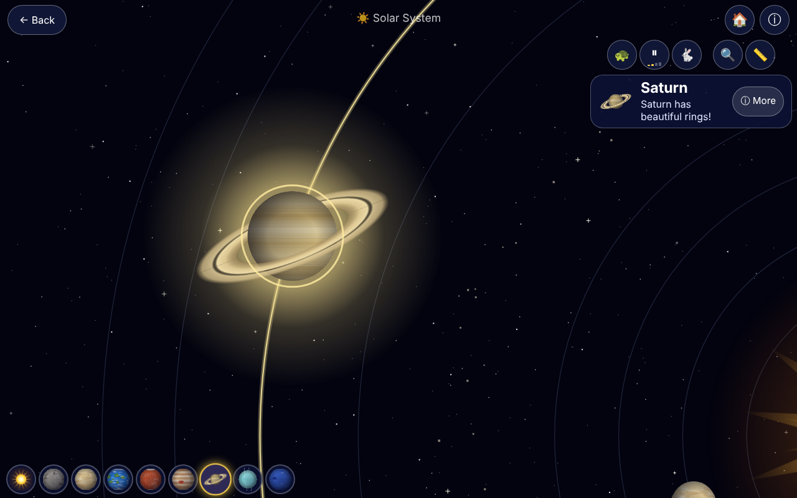
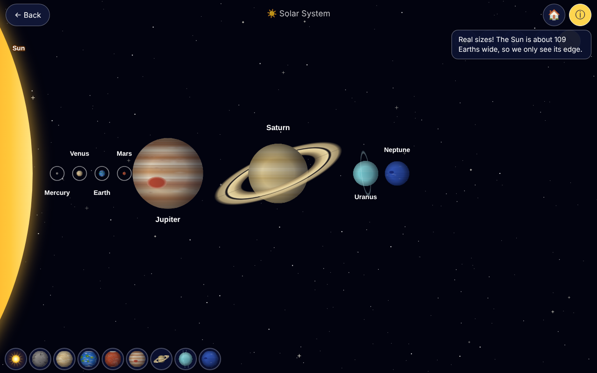
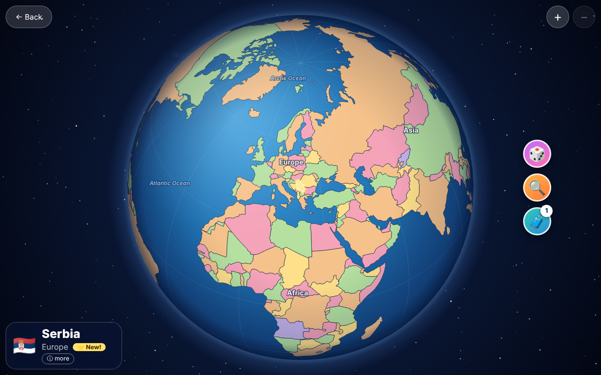

# ToddleToy

ToddleToy is a small collection of touch-first learning toys for young children (roughly ages 1–6, with a grown-up nearby). It runs entirely in the browser, installs as an app, works offline, and collects no data.



## The toys

### 🧸 Toddler Sandbox

Tap, click, press any key or use a gamepad and something appears where you touched: a shape, a letter, a number or an emoji. It is named out loud in each language you have enabled, with a tone whose pitch follows its position and a burst of particles. Things can be dragged around; they tidy themselves away after a while.

Numbers can also be shown in other systems, stacked around the numeral: Cistercian and Kaktovik numerals, binary (as hearts), and place-value counting with apples, bags, boxes and trucks.



Parents choose what appears, how often, and in which languages on a settings screen. An optional **Grid Mode** arranges things in fixed cells instead of free placement.



### 🌞 Solar System

A living model of the eight planets. Drag around the Sun to spin time forwards or backwards, tap a planet (or its button in the strip) to fly alongside it and hear its name, open the card for a few facts, compare the planets at their true relative sizes, or play **Find it!**. Orbital speeds are in the right proportion; sizes and distances in the orbit view are not to scale, and the toy says so.




### 🌍 World Globe

A real globe drawn from Natural Earth country outlines. Drag to spin, pinch or scroll to zoom, tap a country to fly to it and hear its name; the card shows its flag and continent and expands to its capital and its name in your other enabled languages. **Surprise me** jumps somewhere random, **Find it!** is a gentle hunting game with hints and no penalties, and the **passport** collects every country visited.



## Design principles

- **For non-readers.** Every interaction works without reading; text and facts are there for older children and adults.
- **Forgiving.** Large tap targets, nearest-thing-wins hit testing, no wrong answers that punish.
- **Private.** No accounts, no analytics, no network requests after the app has loaded. Settings and progress stay in the browser's local storage.
- **Hard to leave by accident.** In the sandbox the browser's back button is blocked; a grown-up leaves by holding the small ✕ in the top-right corner for two seconds, or by visiting `/admin`.

## Try it

```bash
npm install
```

```bash
npm run dev
```

The dev server runs at http://localhost:4001. Requires Node 20 or newer (the version CI and the Netlify build use).

Routes: `/` toy selector · `/config` sandbox settings · `/toy` sandbox · `/orrery` Solar System · `/globe` World Globe · `/admin` settings (always shown, even if "skip this screen" is on).

## Development

| Command | What it does |
| --- | --- |
| `npm run dev` | Vite dev server on port 4001 (no service worker) |
| `npm run build` | Production build into `dist/`, including the service worker |
| `npm run preview` | Serve the production build locally |
| `npm test` | Jest unit tests (jsdom) |
| `npm run test:e2e:ci` | Playwright end-to-end tests on desktop and mobile Chromium, against a production build (what CI runs) |
| `npm run test:e2e` | The same tests on all five browser projects (needs Firefox and WebKit installed) |
| `npm run lint` | ESLint over `src/` |

A pre-commit hook checks that `package.json`'s version was bumped whenever code changes. CI (`.github/workflows/ci.yml`) runs lint, unit tests, the build and the Chromium end-to-end suite.

See [CONTRIBUTING.md](./CONTRIBUTING.md) for the project layout, conventions and how to add to it, and [docs/README.md](./docs/README.md) for the architecture.

## Languages

Spoken and written labels in the sandbox: English, Spanish, Mandarin Chinese, Hindi, Arabic, French, Bengali, Portuguese, Russian, Indonesian, Esperanto, and for fun Klingon and Lojban. Speech uses the device's own voices (Web Speech API), so which languages are actually spoken depends on the voices installed; Klingon and Lojban are read with an English voice. Without any speech support the toys still work silently.

## Supported environments

Current Chrome, Edge, Safari and Firefox on desktop, Android and iOS/iPadOS. Automated end-to-end tests run on Chromium (desktop and phone emulation); the other browsers are supported by design but are not part of the automated run.

## Known limitations

- The sandbox canvas renders at 1× pixel density, so its text and emoji look slightly soft on high-density phone screens.
- Flag emoji are drawn by the device; desktop Windows shows two-letter codes instead of flags.
- Country outlines are the 1:110m Natural Earth set: very small countries and islands are simplified or missing.
- Card text in the Solar System and continent/ocean labels on the globe are English only.
- Remaining `npm audit` advisories are all in development tooling and need major upgrades of Vite and Jest.

## 🎯 Recommended Settings by Age

### Ages 1-2 (Early Exploration)
- **Content**: Shapes (40%) + Emojis (60%)
- **Emojis**: Animals, Food, Faces
- **Languages**: 1 language (native)
- **Speech**: 0.5x-0.75x speed

### Ages 2-3 (Active Learning)
- **Content**: Shapes, Small Numbers (1-10), UPPERCASE Letters, Emojis
- **Languages**: 1-2 languages
- **Speech**: 0.75x-1.0x speed
- **Try**: Binary Hearts for fun!

### Ages 3-4 (Expanding Horizons)
- **Content**: All content types with balanced weights
- **Numbers**: 0-50 range
- **Languages**: 2-3 languages
- **Advanced**: Enable all number systems, try Grid Mode

### Ages 4+ (Advanced Learning)
- **Content**: All types, emphasize large numbers and letters
- **Numbers**: 0-1000+ range
- **Languages**: 3-4 languages
- **Advanced**: Object Counting (place values), all number systems

## 🔒 Safety Features

ToddleToy is designed with child safety in mind:

- **No ads or external links**: Children can't accidentally leave the app
- **No data collection**: Everything stays on your device
- **PWA Installation**: Install as an app to prevent accidental exits
- **Guided Access (iOS) / Screen Pinning (Android)**: Lock device to ToddleToy
- **Age-appropriate content**: Carefully curated emojis and vocabulary

### Setting Up Safety Features

**iOS - Guided Access:**
1. Settings → Accessibility → Guided Access
2. Enable and set a passcode
3. Open ToddleToy, triple-click side button
4. Tap Start to lock the app

**Android - Screen Pinning:**
1. Settings → Security → Advanced → Screen Pinning
2. Enable "Ask for PIN before unpinning"
3. Open ToddleToy, tap Recent Apps (□)
4. Tap app icon → Pin

## 🔒 Keeping a child in the app

- **Install it** (below) so there is no address bar or tabs.
- **iOS – Guided Access:** Settings → Accessibility → Guided Access, set a passcode, open ToddleToy, triple-click the side button.
- **Android – Screen Pinning:** Settings → Security → Screen Pinning, open ToddleToy, Recent Apps → app icon → Pin.

## 📱 Installation as PWA

### Desktop (Chrome, Edge, Firefox)
1. Look for install icon in address bar
2. Click "Install ToddleToy"
3. App appears in applications menu

### iOS (Safari)
1. Tap Share button (⎙)
2. Scroll down and tap "Add to Home Screen"
3. Tap "Add" in top right

### Android (Chrome)
1. Tap menu button (⋮)
2. Tap "Install app" or "Add to Home screen"
3. Tap "Install" to confirm

## ❓ Getting help

- **ⓘ icons** next to each settings section explain it in plain language; the floating **Need Help?** button lists every topic.
- **[Configuration Guide](./docs/CONFIG-GUIDE.md)** explains every setting.

### Troubleshooting

**Problem: Too overwhelming**
- Reduce number of content types
- Use only 1 language
- Disable special number displays
- Lower weights on less important categories

**Problem: Child loses interest**
- Add more variety (enable more types)
- Add a second language
- Enable special number displays
- Try Grid Mode for structure

**Problem: Wrong difficulty level**
- Too easy: Add letters, large numbers, multiple languages
- Too hard: Focus on shapes and emojis, small numbers (1-10), one language

**Problem: Audio issues**
- Adjust volumes separately (speech vs audio tones)
- Try slower speech speed (0.5x-0.75x)
- Mute audio tones if distracting

## 📄 License

MIT — see [LICENSE](./LICENSE). Bundled third-party components are listed in [THIRD-PARTY-NOTICES.md](./THIRD-PARTY-NOTICES.md).

## 🙏 Acknowledgments

- Gentium Kaktovik font (SIL Open Font License) for Kaktovik numerals
- Natural Earth for country outlines
- Phaser 3
- All the toddlers who inspire better learning tools
